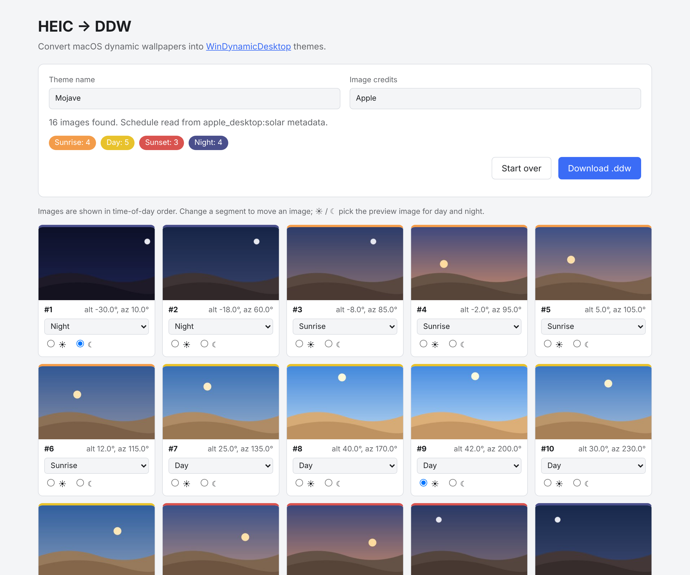
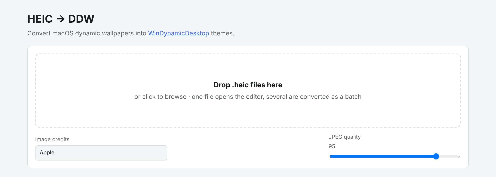
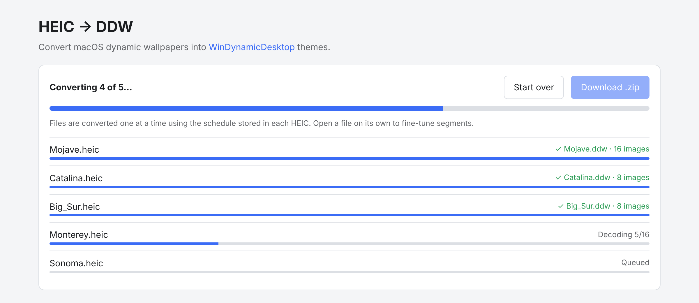

<div align="center">

# HEIC → DDW

**Turn macOS dynamic wallpapers (`.heic`) into [WinDynamicDesktop](https://github.com/t1m0thyj/WinDynamicDesktop) themes (`.ddw`) — in your browser, on your own machine.**

[](https://nodejs.org/)
[](https://expressjs.com/)
[](#-quick-start)
[](https://github.com/t1m0thyj/WinDynamicDesktop)
[](#-privacy)
[](package.json)

<picture>
  <source media="(prefers-color-scheme: dark)" srcset="docs/screenshots/editor-dark.png">
  
</picture>

</div>

---

## Contents

- [What is this?](#-what-is-this)
- [Features](#-features)
- [Quick start](#-quick-start)
- [How to use it](#-how-to-use-it)
  - [1. Get a dynamic wallpaper](#1-get-a-dynamic-wallpaper)
  - [2. Convert a single wallpaper (editor)](#2-convert-a-single-wallpaper-editor)
  - [3. Convert many wallpapers at once (batch)](#3-convert-many-wallpapers-at-once-batch)
  - [4. Install the theme in WinDynamicDesktop](#4-install-the-theme-in-windynamicdesktop)
- [How images are sorted into segments](#-how-images-are-sorted-into-segments)
- [What's inside a .ddw file?](#-whats-inside-a-ddw-file)
- [Configuration](#-configuration)
- [Troubleshooting](#-troubleshooting)
- [Privacy](#-privacy)
- [Project layout](#-project-layout)
- [Credits](#-credits)

---

## 🤔 What is this?

macOS ships **dynamic wallpapers**: a single `.heic` file that holds many photos of the same scene at different times of day, along with a hidden schedule telling macOS when to show each one.

**WinDynamicDesktop** brings the same idea to Windows, but it uses its own theme format, `.ddw`.

This tool bridges the two. Drop in a `.heic`, and it:

1. Pulls out every frame inside the file,
2. Reads Apple's hidden schedule and sorts each frame into **Sunrise**, **Day**, **Sunset** or **Night**,
3. Lets you review and tweak the result,
4. Hands you a ready-to-install `.ddw` theme.

It runs as a small local web app: a Node.js server on your PC plus a page in your browser. Nothing is uploaded to the internet.

## ✨ Features

- 🖱️ **Drag & drop**: drop one file to open the editor, or several to convert them all.
- 🧠 **Reads Apple's schedule automatically**: supports sun-position (`solar`), time-of-day (`h24`) and light/dark (`apr`) wallpapers.
- 🎛️ **Visual editor**: thumbnails sorted by time of day, a segment picker for each image, and live counts per segment.
- ☀️ / ☾ **Preview images**: choose which frame WinDynamicDesktop shows as the day and night preview.
- 📦 **Batch mode**: convert a whole folder of wallpapers into one `.zip` of `.ddw` themes.
- 🎚️ **Adjustable JPEG quality** (70–100) to trade file size against detail.
- 🧹 **Lean output**: frames you mark as *Unused* are left out of the theme.
- 🌗 **Light and dark UI** that follows your system setting.
- 🔒 **Fully offline**: the server only listens on `127.0.0.1`.

## 🚀 Quick start

### Prerequisites

- **[Node.js](https://nodejs.org/) 20.9 or newer.** The LTS installer is the easy choice. To check what you have, open a terminal and run `node -v`.
- **[WinDynamicDesktop](https://github.com/t1m0thyj/WinDynamicDesktop)** on the Windows PC where you want the wallpaper. You can get it from the Microsoft Store or GitHub.

### Windows: the easy way

1. **Download** this repository: click the green **Code** button → **Download ZIP**, then unzip it anywhere. If you use Git, `git clone https://github.com/shanujha/heic-to-ddw.git` works too.
2. **Double-click `start.bat`.**
   - The first run installs dependencies automatically, which takes a minute.
   - Your browser then opens **http://localhost:5178** on its own.
3. Keep the black console window open while you use the converter. Close it when you're done.

### macOS / Linux (or Windows from a terminal)

```bash
git clone https://github.com/shanujha/heic-to-ddw.git
cd heic-to-ddw
npm install
npm start
```

Then open **http://localhost:5178** in your browser. The browser only opens by itself on Windows. Press `Ctrl + C` in the terminal to stop the server.

## 📖 How to use it

<p align="center">
  
</p>

The start screen has three parts:

| Control | What it does |
| --- | --- |
| **Drop zone** | Drop `.heic` / `.heif` files here, or click it to browse. **One file** opens the editor. **Several files** start a batch. |
| **Image credits** | Optional. Saved in the theme and shown in WinDynamicDesktop (for example `Apple`). |
| **JPEG quality** | Quality of the frames saved in the theme. **95** is the default and looks great. Lower values make smaller files. |

### 1. Get a dynamic wallpaper

You need a **dynamic** `.heic`, meaning one that contains several frames. A normal HEIC photo from a phone has only one image and won't make a useful theme.

Where to find one:

- **On a Mac:** older macOS versions keep the built-in wallpapers (Mojave, Catalina, Big Sur…) in `/System/Library/Desktop Pictures/`. Newer versions download them on demand, usually into `/Library/Application Support/com.apple.mobileAssetDesktop/`. Copy the `.heic` files to your Windows PC.
- **Online:** many artists share free dynamic wallpapers as `.heic` files, for example on [dynamicwallpaper.club](https://dynamicwallpaper.club/).

> [!NOTE]
> Wallpapers are artwork and belong to their creators. Convert them for your own use, and fill in **Image credits** if you share a theme.

### 2. Convert a single wallpaper (editor)

Use this when you want full control.

1. **Drop one `.heic`** onto the page. A progress bar appears while each frame is decoded. Big wallpapers (16 frames at 5K) can take a little while.
2. **The editor opens.** At the top:
   - **Theme name**: starts as the file name. This becomes the theme's name in WinDynamicDesktop.
   - **Image credits**: copied from the start screen. You can change it here.
   - A note telling you **how many images were found** and **which schedule was read** (for example *Schedule read from apple_desktop:solar metadata*).
   - **Coloured chips** counting the images in each segment.
3. **Review the thumbnails.** They are sorted in time-of-day order, and each has:
   - A **coloured bar** showing its segment (orange = sunrise, yellow = day, red = sunset, indigo = night, grey = unused).
   - A label with its **sun position** (`alt 25.0°, az 135.0°`) or **time** (`06:30`) from the original schedule.
   - A **segment dropdown**. Change it to move the image into another segment, or pick **Unused** to leave it out.
   - **☀ / ☾ radio buttons** to choose the day and night **preview image**.
4. Click **Download .ddw**. The button stays disabled until there is **at least one Day image and one Night image**, because WinDynamicDesktop needs both.

> [!TIP]
> The automatic sorting is usually right. If a frame looks wrong, for example a dusky "day" image, move it to Sunrise or Sunset. Within each segment, WinDynamicDesktop spreads the images evenly between sunrise and sunset times for your location.

### 3. Convert many wallpapers at once (batch)

<p align="center">
  
</p>

1. Set **Image credits** and **JPEG quality** first. They apply to every file in the batch.
2. **Drop several `.heic` files at once**, or select several in the file browser.
3. Files are converted **one at a time** to keep memory use reasonable. Each one uses its built-in schedule with no editing step.
4. When everything has finished, click **Download .zip**. You get `ddw-themes.zip` with one `.ddw` per wallpaper.

Files that fail (for example, a HEIC with no dynamic-wallpaper schedule) are marked with ✗ and a reason. The rest are still included. To rescue a failed file, drop it on its own and assign segments by hand in the editor.

### 4. Install the theme in WinDynamicDesktop

1. **Double-click the `.ddw` file.** WinDynamicDesktop imports it automatically.
   *Or:* open WinDynamicDesktop → **Select Theme** → **Import from file…** and pick the `.ddw`. For a batch, unzip `ddw-themes.zip` first.
2. Select the new theme and click **Apply**.
3. If you haven't already, set your **location** (or use Windows location services) in WinDynamicDesktop so it knows when your sunrise and sunset are.

That's it — your desktop now changes through the day 🌅 → 🌞 → 🌇 → 🌙

## 🧭 How images are sorted into segments

macOS hides the schedule as a binary plist inside the file's XMP metadata. The tool reads whichever of these it finds:

| Apple metadata | What it stores | How each frame is assigned |
| --- | --- | --- |
| `apple_desktop:solar` | Sun **altitude** and **azimuth** for each frame | altitude ≥ 15° → **Day**<br>altitude ≤ −10° → **Night**<br>in between → **Sunrise** (morning sky, azimuth < 180°) or **Sunset** (evening sky) |
| `apple_desktop:h24` | A **time of day** for each frame | 05:00–08:00 → **Sunrise**<br>08:00–17:00 → **Day**<br>17:00–20:00 → **Sunset**<br>otherwise → **Night** |
| `apple_desktop:apr` | Only a **light** and a **dark** image | light → **Day**, dark → **Night** |
| *(none found)* | — | Every frame starts as **Day**. Assign segments yourself in the editor. |

Two extra rules:

- **Every theme needs at least one Day and one Night image.** If a sparse schedule misses one, the frame closest to noon (or midnight) is promoted to fill the gap.
- **Preview images:** if the file names a light/dark appearance, those frames become the default ☀ / ☾ picks.

## 📦 What's inside a .ddw file?

A `.ddw` is a plain ZIP archive:

```
Mojave.ddw
├── theme.json
├── Mojave_1.jpg
├── Mojave_2.jpg
└── …
```

`theme.json` looks like this:

```json
{
  "displayName": "Mojave",
  "imageFilename": "Mojave_*.jpg",
  "imageCredits": "Apple",
  "dayHighlight": 9,
  "nightHighlight": 1,
  "sunriseImageList": [3, 4, 5, 6],
  "dayImageList": [7, 8, 9, 10, 11],
  "sunsetImageList": [12, 13, 14],
  "nightImageList": [15, 16, 1, 2]
}
```

- Only images that are actually used get packed, numbered `1…n`.
- The night list runs from evening, past midnight, into the early morning.
- The file name keeps letters, numbers, spaces, `_` and `-` from the theme name, with spaces turned into underscores.

## ⚙️ Configuration

| Setting | Default | How to change |
| --- | --- | --- |
| Port | `5178` | Set the `PORT` environment variable, e.g. `PORT=8080 npm start` (PowerShell: `$env:PORT=8080; npm start`) |
| Auto-open browser | On (Windows only) | Start with `node server.js --no-open` |
| Temporary files | `<system temp>/heic-to-ddw-jobs` | Cleared each time the server starts, and when you click **Start over** |

## 🛠️ Troubleshooting

<details>
<summary><b><code>'node' is not recognized…</code> / <code>npm: command not found</code></b></summary>

Node.js isn't installed, or the terminal was opened before you installed it. Install Node.js 20.9+ from [nodejs.org](https://nodejs.org/), then **open a new terminal** (or run `start.bat` again).
</details>

<details>
<summary><b><code>npm install</code> fails while installing <code>sharp</code></b></summary>

`sharp` downloads a prebuilt binary for your system. Make sure you're on Node.js **20.9 or newer** and have an internet connection, then delete the `node_modules` folder and run `npm install` again. On unusual platforms, see the [sharp installation guide](https://sharp.pixelplumbing.com/install).
</details>

<details>
<summary><b>Port 5178 is already in use (<code>EADDRINUSE</code>)</b></summary>

Another copy of the converter is probably still running. Close that console window, or start on another port: `PORT=5200 npm start`.
</details>

<details>
<summary><b>“No macOS dynamic-wallpaper metadata found”</b></summary>

The file has no Apple schedule. It might be a regular photo, or a dynamic wallpaper that was re-saved by another app, which strips the metadata. All frames start as **Day**: assign Sunrise / Sunset / Night yourself, then download. In batch mode such files are skipped with an error. Convert them one at a time instead.
</details>

<details>
<summary><b>The Download .ddw button is greyed out</b></summary>

A theme needs at least **one Day** and **one Night** image. The message under the button tells you what's missing.
</details>

<details>
<summary><b>Decoding is slow or uses a lot of memory</b></summary>

Dynamic wallpapers often hold 16 frames at 5K–6K resolution, and HEIC decoding runs in WebAssembly. Expect a short wait per file. Batch mode deliberately processes one file at a time so memory use stays flat.
</details>

<details>
<summary><b>The .ddw is too large</b></summary>

Lower **JPEG quality** on the start screen (85–90 is still very good), or mark near-duplicate frames as **Unused**.
</details>

## 🔒 Privacy

Everything happens on your computer. The server binds to `127.0.0.1`, so other devices can't reach it, and files are never sent anywhere else. Uploaded files and decoded frames live in a temporary folder that is deleted when you click **Start over** and whenever the server starts.

## 🗂️ Project layout

```
heic-to-ddw/
├── server.js          # Express server: upload, decode jobs, .ddw / .zip packaging
├── start.bat          # Windows launcher (installs deps on first run)
├── src/
│   ├── worker.js      # Decodes HEIC frames to JPEG in a worker thread
│   └── metadata.js    # Reads Apple's schedule, maps frames to segments
├── public/            # The browser UI (plain HTML/CSS/JS, no build step)
└── docs/screenshots/  # Images used in this README
```

Built with [Express](https://expressjs.com/), [heic-decode](https://github.com/catdad-experiments/heic-decode) (libheif), [sharp](https://sharp.pixelplumbing.com/), [bplist-parser](https://github.com/joeferner/node-bplist-parser) and [archiver](https://github.com/archiverjs/node-archiver).

## 🙏 Credits

- [WinDynamicDesktop](https://github.com/t1m0thyj/WinDynamicDesktop) by Timothy Johnson, which makes dynamic desktops possible on Windows.
- Apple, for the dynamic wallpaper format and the beautiful wallpapers.

<sub>The thumbnails in the screenshots above are illustrative placeholders, not real wallpaper content.</sub>
